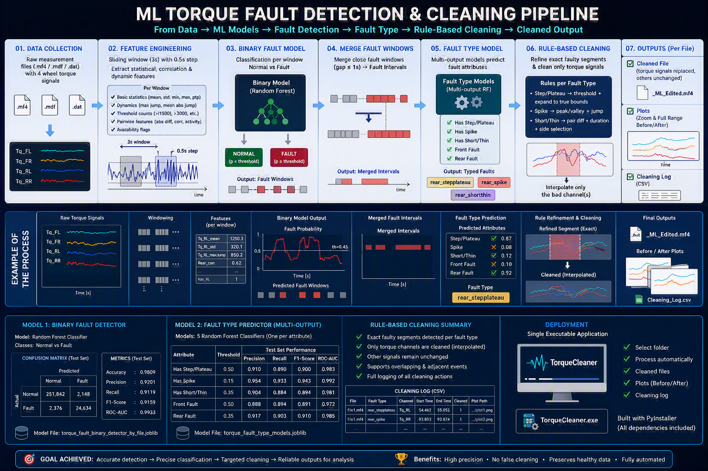

# Automotive AI & Vehicle Signal Intelligence

### Volvo Cars · Summer 2026 · Personal engineering portfolio

**Machine learning · Vehicle telemetry · Signal processing · Automated fault cleaning · Peak torque prediction**

> Engineering work carried out during a summer placement in Data Analytics & Component Verification. Personal portfolio; not an official Volvo Cars product. The author reports permission to share the attached project materials.



## Overview

This portfolio presents three related but distinct automotive data analytics projects, from raw MDF/MF4 measurement files to reproducible signal cleaning and machine-learning analysis.

| Project | Problem | Engineering solution |
|---|---|---|
| **01 — ML torque fault detection & cleaning** | Torque measurements contain spikes, steps/plateaus, short faults, and faulty wheel channels | Sliding-window features, Random Forest binary screening, multi-output fault typing, merged intervals, targeted interpolation, validation plots |
| **02 — Measurement signal quality improvement** | Manual cleaning of wheel-torque and temperature data is time-consuming | Batch MDF/MF4/DAT processing, rule-based detection, paired-channel substitution, configurable cleaning, edited measurement outputs |
| **03 — Peak torque / over-torque prediction** | High-load events cannot be directly measured in every vehicle | Driving-behavior features, XGBoost classification, predicted time windows and event-level evaluation without wheel torque as a prediction input |

## 01 · ML torque fault detection & automated cleaning

The documented pipeline processes four wheel-torque channels (front-left, front-right, rear-left, rear-right). It creates overlapping windows, extracts statistical and dynamic features, classifies normal versus faulty windows, predicts fault attributes, merges adjacent detections, refines exact regions with engineering rules, and interpolates only the affected signals. It supports FWD, RWD and AWD vehicle configurations.

**Binary detector results (test set, as shown in the supplied pipeline diagram):**

| Metric | Result |
|---|---:|
| Accuracy | **98.09%** |
| Precision | **92.01%** |
| Recall | **91.19%** |
| F1-score | **91.59%** |
| ROC-AUC | **0.9933** |

**Fault attribute results (from the supplied project report):**

| Attribute | Precision | Recall | F1 |
|---|---:|---:|---:|
| Step/plateau | 100.0% | 95.6% | 97.8% |
| Spike | 69.5% | 100.0% | 82.0% |
| Short/thin | 94.6% | 61.9% | 74.9% |
| Front fault | 99.6% | 99.8% | 99.7% |
| Rear fault | 100.0% | 99.2% | 99.6% |

*Metric provenance: binary metrics from the provided pipeline graphic; fault-type metrics from `docs/ML_FAULT_CLEANING_REPORT.txt`. These may describe different evaluation runs and should not be treated as one matched experiment.*

The report identifies a consolidated `ML_CLEANING_PIPELINE_ML_OUTPUT.py` and a packaged `TorqueCleaner.exe`, **neither of which was among the supplied attachments**. They are therefore described, not included or reconstructed.

## 02 · Rule-based vehicle measurement signal cleaning

Three supplied Python scripts are included in [`src/signal_cleaning/`](src/signal_cleaning/). They use `asammdf`, NumPy, pandas and Matplotlib to process measurement files, repair anomalous intervals, generate comparison plots and preserve original source files. The combined tool provides automatic wheel-torque cleaning and custom paired-channel temperature-oriented rules. The scripts are shared as supplied rather than refactored or claimed to have been tested in this environment.

## 03 · Peak torque event prediction

A separate supervised pipeline identifies high wheel-torque peak windows from **vehicle behavior signals**, excluding measured wheel torque from the prediction feature matrix. Torque measurements are used for training labels and engineering validation. The supplied documentation describes peak detection (≥1800 Nm), overlapping 5-second windows, XGBoost training, inference, event merging and event-level scoring.

The pipeline documentation references scripts such as `03A_train_peak_prediction_xgboost.py` and `09_overtorque_pipeline.py`; those files were **not attached** and are not included here. No unverified prediction-performance numbers are claimed.

## Repository contents

```text
assets/                   Pipeline infographic
src/signal_cleaning/      Three original attached Python scripts
presentations/            Attached technical PDFs and ML presentation
 docs/                    Fault-cleaning report and repository notes
README.md                 Project overview and documented metrics
requirements.txt          Main Python dependencies
.gitignore                Excludes measurements, trained models and outputs by default
```

## Getting started (cleaning scripts)

```bash
python -m venv .venv
# Windows: .venv\Scripts\activate
pip install -r requirements.txt
python src/signal_cleaning/Data_clean_substitute_interpolation_Custom.py
```

The scripts open desktop folder-selection dialogs and may require Windows/network path adjustments. Run on copies of test measurements, review before/after plots and logs, and validate output MF4 files before engineering use. There is no sample measurement dataset in this repository.

## Technical stack

`Python` · `NumPy` · `pandas` · `scikit-learn` · `Random Forest` · `XGBoost` · `asammdf` · `Matplotlib` · `MDF/MF4` · `Time-series feature engineering` · `Signal interpolation` · `Model evaluation`

## Engineering impact

- Built workflows that combine data processing, ML screening, fault typing, precise localization and signal repair.
- Automated multi-file signal-quality workflows with before/after visualization and traceable logs.
- Designed an ML prediction workflow that avoids using the target wheel-torque measurements as inference features.
- Documented deliverables for engineering review and standalone packaging.

## Source material

See [`presentations/`](presentations/) for the supplied final presentation, introductory ML talk and engineering user guides. See [`docs/ML_FAULT_CLEANING_REPORT.txt`](docs/ML_FAULT_CLEANING_REPORT.txt) for the ML fault-cleaning project report.

## Publication and attribution

This repository is a personal portfolio, not an official Volvo Cars repository. Publication permission is reported by the author. Only files supplied in this conversation are included. The `.gitignore` excludes raw measurements and model binaries by default to prevent accidental addition of unrelated data.
